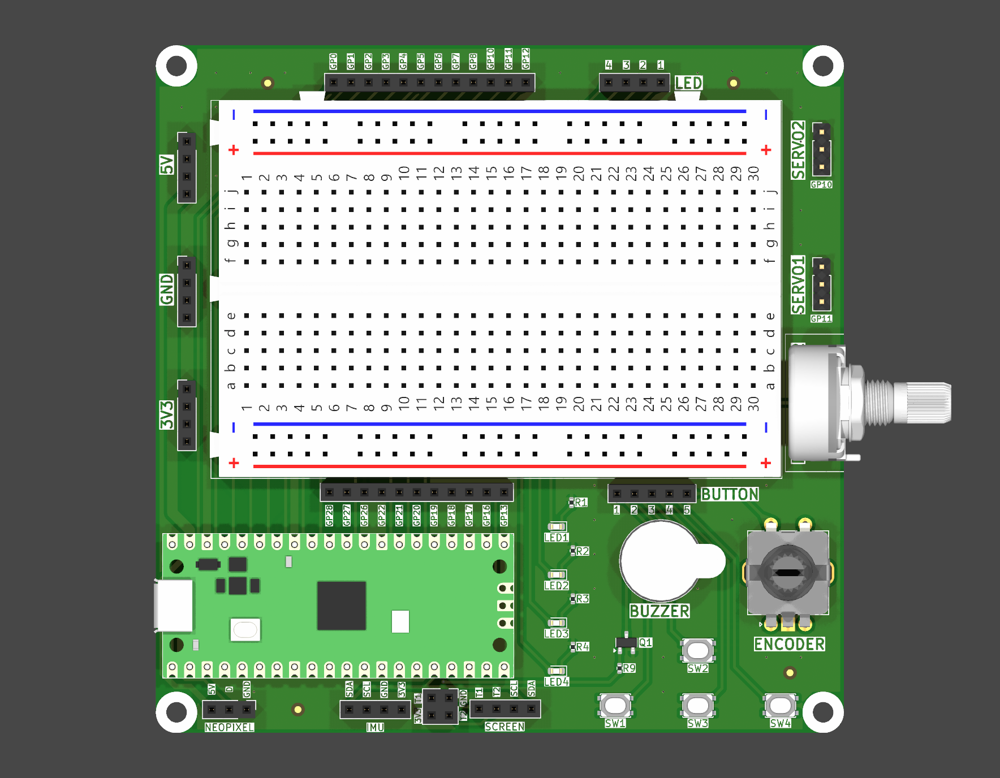

# Pico Breadboard Kit

This is a Raspberry Pi Pico breadboard kit designed for students to learn and experiment with basic electronics and microcontroller programming.



| | |
|---|---|
| **Schematic** | [PDF](docs/schematic.pdf) · [SVG](docs/schematic.svg) |
| **Gerbers + drill** | [pico-breadboard-gerbers.zip](fabrication/pico-breadboard-gerbers.zip) |
| **Bill of materials** | [pico-breadboard-bom.csv](fabrication/pico-breadboard-bom.csv) |
| **Pick and place** | [KiCad CSV](fabrication/pico-breadboard-top-pos.csv) · [Neoden YY1](fabrication/pico-breadboard-neoden-yy1.csv) |
| **KiCad project** | [hardware/pico-breadboard.kicad_pro](hardware/pico-breadboard.kicad_pro) |
| **Previous version** | [v1.0 release](https://github.com/rustemsevik/pico-Breadboard-Kit/releases/tag/v1.0) |

## Features

- **Raspberry Pi Pico** with full GPIO breakout  
- **Four tactile buttons** connected to GPIOs  
- **Four LEDs** with current-limiting resistors  
- **Buzzer** controlled via transistor switch  
- **Rotary encoder with push switch** for interactive input  
- **Potentiometer** connected to ADC input  
- **Headers for external 3.3V and 5V power**  
- **Dedicated I2C connector for screen (SCL/SDA)**  
- **Connector for MPU6050 (I2C accelerometer/gyroscope)**  
- **Servo motor headers (2x) with GPIO control**  
- **Neopixel header** for addressable LED strips  
- Mounting holes for mechanical stability  
- All components are laid out to be easily accessible on a standard breadboard.

## Getting Started

1. Insert the Raspberry Pi Pico into the breadboard.  
2. Connect power via USB.  
3. Upload your code using Thonny or the Pico SDK.  
4. Use the built-in components (buttons, LEDs, buzzer, potentiometer, rotary encoder, servos) to test your logic.  
5. Connect external devices (screen, MPU6050, Neopixel) via the dedicated headers.  

## Repository Layout

```
hardware/       KiCad 10 project (schematic, PCB, project library)
  lib/          PicoBreadboard symbols, footprints and 3D models
fabrication/    Gerber zip, BOM, pick-and-place files
docs/           Schematic (PDF/SVG) and 3D renders
scripts/        export.sh: regenerates fabrication/ and docs/
```

## Opening the Design Files

The hardware is designed in **KiCad 10** and will not open in older versions. Open [`hardware/pico-breadboard.kicad_pro`](hardware/pico-breadboard.kicad_pro).

All symbols, footprints and 3D models are included in the project library [`hardware/lib/`](hardware/lib) (`PicoBreadboard`), so the project works right after cloning, with no library setup.

## Manufacturing

Upload [`fabrication/pico-breadboard-gerbers.zip`](fabrication/pico-breadboard-gerbers.zip) to your PCB manufacturer.

| Parameter | Value |
|---|---|
| Layers | 2 |
| Board size | 100 × 100 mm |
| Thickness | 1.6 mm |
| Smallest drill | 0.3 mm |

Pick-and-place coordinates use the bottom-left corner of the board as the origin and include SMD parts on the top side only.

## Regenerating Outputs

After changing the design, regenerate everything in `fabrication/` and `docs/` with:

```bash
scripts/export.sh
```

The script needs `kicad-cli` from KiCad 10. It runs ERC/DRC first and reports any errors; use `--strict` to stop on errors. The Neoden YY1 file contains machine feeder settings and is maintained by hand.

## Previous Versions

**v1** (two buttons, four LEDs, buzzer, I2C screen header) is archived in the [v1.0 release](https://github.com/rustemsevik/pico-Breadboard-Kit/releases/tag/v1.0), with gerbers, schematic and the KiCad project. The source is also available at the [`v1.0` tag](https://github.com/rustemsevik/pico-Breadboard-Kit/tree/v1.0/v1).

---

This kit is ideal for beginner to intermediate-level microcontroller projects, robotics experiments, and educational settings.
